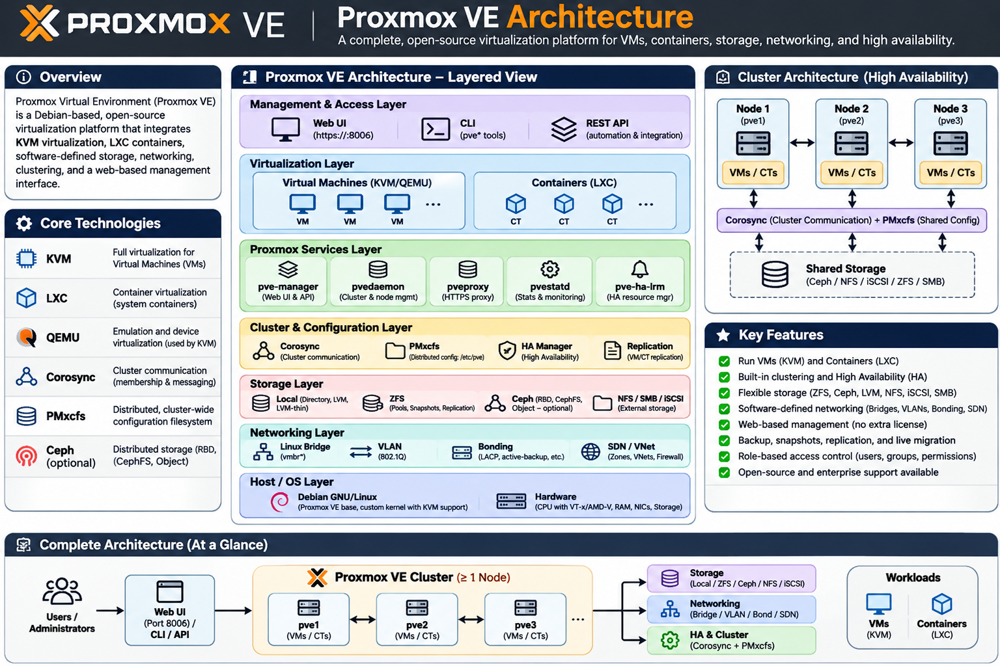

# Module 02 — Proxmox VE Architecture

## 1. Overview

Proxmox Virtual Environment (Proxmox VE) is an open-source virtualization platform built on Debian GNU/Linux. It integrates KVM for full virtualization and LXC for operating-system-level virtualization, providing centralized management of virtual machines, containers, storage, networking, clustering, and high availability.

## 2. Learning Objectives

By completing this module, you will be able to:

1. Explain the complete Proxmox VE architecture.
2. Understand the relationship between `Debian Linux`, `KVM`, `QEMU`, and `Proxmox VE`.
3. Differentiate `KVM virtual machines` from `LXC containers`.
4. Understand Proxmox management architecture and services.
5. Understand Proxmox storage architecture.
6. Understand Proxmox networking architecture.
7. Explain cluster communication and distributed management.
8. Understand the VM lifecycle from creation to execution.
9. Explain Ceph integration with Proxmox VE.
10. Relate Proxmox architecture to a multi-node private cloud environment.

---

## 3. Proxmox VE Architecture — Layer by Layer

### 3.1 Physical Infrastructure Layer

This is the underlying hardware infrastructure on which Proxmox VE operates.

| Component          | Responsibility                                               |
| ------------------ | ------------------------------------------------------------ |
| CPU                | Executes instructions and provides virtualization extensions |
| Memory             | Provides RAM for the hypervisor and workloads                |
| Storage            | Stores VM disks, container data, and system files            |
| Network Interfaces | Connects nodes, VMs, containers, and external networks       |
| Hardware           | Physical server components and devices                       |

**Homelab architecture:**

```text
Physical Host
    |
    +-- Intel Core i5-1335U
    +-- 23 GB RAM
    +-- NVMe Storage
    +-- Ubuntu 24.04.5
    |
    +-- VirtualBox
          |
          +-- PVE01
          +-- PVE02
          +-- PVE03
```

> Note: This environment uses nested virtualization. VirtualBox provides virtual hardware to the Proxmox VE nodes.

### 3.2 Foundation Layer — Debian GNU/Linux

Proxmox VE is built on Debian GNU/Linux.

Debian provides the operating-system foundation:

- Linux kernel
- Hardware and device drivers
- Networking stack
- Filesystem support
- Package management
- System services
- Security mechanisms

Proxmox extends this foundation with virtualization, storage, networking, clustering, and management capabilities.

**Important:** Proxmox VE is a specialized virtualization platform built around the Linux kernel, rather than simply an application running on a general-purpose desktop operating system.

### 3.3 Virtualization Layer

The virtualization layer provides two major workload technologies: KVM and LXC.

#### A. KVM — Kernel-based Virtual Machine

KVM enables hardware-assisted full virtualization.

It allows independent guest operating systems to run on a Proxmox VE node.

Examples:

- Ubuntu Server
- Debian
- Windows Server
- Kali Linux
- Red Hat Enterprise Linux

KVM uses CPU virtualization extensions:

- Intel VT-x
- AMD-V

**KVM responsibilities:**

- CPU virtualization
- Hardware-assisted execution
- Memory virtualization
- Guest isolation through virtualization mechanisms

**QEMU Integration:**

QEMU provides the user space virtual machine monitor and virtual hardware/device emulation. Proxmox integrates QEMU with KVM to run virtual machines.

#### B. LXC — Linux Containers

LXC provides operating-system-level virtualization.

Containers share the host Linux kernel but maintain isolated user spaces and resources.

Typical workloads:

- Web servers
- Application services
- Lightweight Linux workloads
- Development environments
- Supporting infrastructure services

#### KVM vs. LXC

| Feature           | KVM Virtual Machine       | LXC Container              |
| ----------------- | ------------------------- | -------------------------- |
| Virtualization    | Hardware-assisted         | OS-level                   |
| Kernel            | Independent guest kernel  | Shared host kernel         |
| Guest OS          | Linux or Windows          | Linux distributions        |
| Resource overhead | Generally higher          | Generally lower            |
| Isolation         | Virtual hardware boundary | Kernel-based isolation     |
| Workloads         | Full operating systems    | Lightweight Linux services |

### 3.4 Storage Layer

Proxmox VE supports multiple storage technologies.

| Storage Technology | Description                            |
| ------------------ | -------------------------------------- |
| Directory          | Filesystem-based storage               |
| LVM                | Logical Volume Manager                 |
| LVM-Thin           | Thin-provisioned logical volumes       |
| ZFS                | Advanced filesystem and volume manager |
| NFS                | Network File System                    |
| iSCSI              | Block storage over IP                  |
| Ceph               | Distributed storage platform           |

**Important storage concepts:**

- Local storage: Storage physically or logically attached to an individual node.
- Shared storage: Storage accessible by multiple cluster nodes.
- Distributed storage: Data distributed across multiple storage nodes.
- Block storage: Storage presented as addressable blocks.
- File storage: Data accessed through a filesystem.
- Thin provisioning: Storage capacity allocated dynamically.

For this private cloud project, the primary focus will be:

1. Local storage
2. LVM and LVM-Thin
3. ZFS architecture
4. Ceph distributed storage
5. Ceph RBD integration

> Ceph is a distributed storage system, not simply a local disk format. It provides storage services across multiple nodes.

### 3.5 Network Layer

Proxmox VE uses the Linux networking stack.

| Component          | Purpose                                      |
| ------------------ | -------------------------------------------- |
| Linux Bridge       | Connects VMs and containers to networks      |
| VLAN               | Provides Layer 2 network segmentation        |
| Bonding            | Combines physical network interfaces         |
| Management Network | Provides Proxmox administration access       |
| Storage Network    | Carries storage-related traffic              |
| Isolated Network   | Separates workloads or tenants               |
| SDN                | Provides software-defined network management |
| VXLAN              | Provides overlay network connectivity        |

Advanced networking topics include:

- VLAN-aware bridges
- Network segmentation
- Bonding modes
- Dedicated storage networks
- Cluster communication networks
- Software-defined networking
- VXLAN overlays
- Network isolation

### 3.6 Management Layer

The management layer provides centralized administration and automation.

#### Web UI

The Proxmox Web UI provides browser-based management.

Main capabilities:

- Node management
- VM and container lifecycle management
- Storage configuration
- Network configuration
- Cluster administration
- Monitoring
- Backup management
- User and permission management

#### REST API

Proxmox provides a REST API for automation and external integrations.

Common integration technologies:

- Terraform
- Ansible
- Python
- Bash
- External orchestration platforms

#### Important Management Components

| Component     | Responsibility                                |
| ------------- | --------------------------------------------- |
| `pveproxy`    | HTTPS Web UI and API access                   |
| `pvedaemon`   | Privileged management operations              |
| `pvestatd`    | Collects and updates resource statistics      |
| `pve-cluster` | Cluster configuration filesystem              |
| `corosync`    | Cluster communication and membership          |
| `pve-ha-crm`  | High-availability cluster resource management |
| `pve-ha-lrm`  | Local HA resource management                  |

---

## 4. Complete Proxmox VE Architecture Diagram

```text
                  ADMINISTRATOR
                        |
                        v
              +--------------------+
              |  PROXMOX WEB UI    |
              |  REST API          |
              +--------------------+
                        |
                        v
              +--------------------+
              | MANAGEMENT LAYER   |
              |                    |
              | pveproxy           |
              | pvedaemon          |
              | pvestatd           |
              | pve-cluster        |
              +--------------------+
                        |
             +----------+----------+
             |                     |
             v                     v
     +---------------+     +---------------+
     | KVM / QEMU    |     | LXC           |
     | Virtual       |     | Containers    |
     | Machines      |     |               |
     +---------------+     +---------------+
             |                     |
             +----------+----------+
                        |
                        v
              +--------------------+
              | STORAGE LAYER      |
              |                    |
              | Directory         |
              | LVM / LVM-Thin     |
              | ZFS                |
              | NFS / iSCSI        |
              | Ceph RBD           |
              +--------------------+
                        |
                        v
              +--------------------+
              | NETWORK LAYER      |
              |                    |
              | Linux Bridges      |
              | VLANs              |
              | Bonding            |
              | SDN / VXLAN        |
              +--------------------+
                        |
                        v
              +--------------------+
              | DEBIAN GNU/LINUX   |
              | LINUX KERNEL       |
              +--------------------+
                        |
                        v
              +--------------------+
              | PHYSICAL HARDWARE  |
              +--------------------+
```



### Six major architectural components

| Component             | Technology         | Responsibility                     |
| --------------------- | ------------------ | ---------------------------------- |
| Hypervisor            | Proxmox VE         | VM and container management        |
| Virtualization        | KVM/QEMU and LXC   | Workload virtualization            |
| Cluster communication | Corosync           | Cluster membership and quorum      |
| Cluster configuration | PMXCFS             | Distributed cluster configuration  |
| Distributed storage   | Ceph               | Replicated and distributed storage |
| High availability     | Proxmox HA Manager | Workload recovery and failover     |

### I recommend separating traffic logically

| Network      | Purpose                      | Example subnet |
| ------------ | ---------------------------- | -------------- |
| Management   | Proxmox administration       | 10.10.10.0/24  |
| Corosync     | Cluster communication        | 10.10.20.0/24  |
| Ceph Public  | Client and storage access    | 10.10.30.0/24  |
| Ceph Cluster | OSD replication and recovery | 10.10.40.0/24  |
| VM Network   | Application workloads        | 10.10.50.0/24  |
| Migration    | VM migration traffic         | 10.10.60.0/24  |

### Ceph distributed storage architecture and Responsibilities

| Ceph Component | Full Name             | Primary Responsibility                                                              | Key Responsibilities                                                                                                                                                                                                                                                                                                                          | Applicable Service / Technology                |
| -------------- | --------------------- | ----------------------------------------------------------------------------------- | --------------------------------------------------------------------------------------------------------------------------------------------------------------------------------------------------------------------------------------------------------------------------------------------------------------------------------------------- | ---------------------------------------------- |
| **MON**        | Monitor               | Maintains cluster state, cluster maps, and quorum.                                  | - Maintains the Monitor Map (MONMAP).<br>- Maintains the OSD Map (OSDMAP).<br>- Maintains the CRUSH Map.<br>- Maintains the authentication database.<br>- Participates in monitor quorum.<br>- Provides authoritative cluster-state information to clients and other daemons.                                                                 | All Ceph services: RBD, CephFS, RGW            |
| **MGR**        | Manager               | Provides cluster management, monitoring, metrics, and administrative functionality. | - Collects cluster statistics.<br>- Provides monitoring and dashboard functionality.<br>- Exposes performance metrics.<br>- Supports management modules and plugins.<br>- Provides REST API and Prometheus integration through applicable modules.<br>- Supports cluster health reporting.                                                    | Ceph Dashboard, Prometheus, management modules |
| **OSD**        | Object Storage Daemon | Stores data and manages data placement, replication, recovery, and rebalancing.     | - Stores objects on physical storage devices.<br>- Handles read/write operations.<br>- Performs data replication or erasure coding.<br>- Participates in data recovery and backfilling.<br>- Reports storage health and utilization.<br>- Maintains object consistency through internal mechanisms.<br>- Works with CRUSH for data placement. | RADOS, Ceph RBD, CephFS, RGW                   |
| **MDS**        | Metadata Server       | Manages filesystem metadata for CephFS.                                             | - Manages directories and file metadata.<br>- Handles filesystem namespace operations.<br>- Manages metadata caching and coordination.<br>- Coordinates filesystem operations between clients.<br>- Supports active and standby MDS deployments.<br>- Does not store CephFS file contents; those are stored by OSDs.                          | CephFS                                         |

### Additional Ceph Architectural Components

| Component  | Full Name                                     | Responsibility                                                   | Key Functions                                                                                                                           |
| ---------- | --------------------------------------------- | ---------------------------------------------------------------- | --------------------------------------------------------------------------------------------------------------------------------------- |
| **RADOS**  | Reliable Autonomic Distributed Object Store   | Provides the underlying distributed object storage layer.        | Stores objects across OSDs, manages replication, recovery, and distributed data access.                                                 |
| **CRUSH**  | Controlled Replication Under Scalable Hashing | Determines where data is placed across the cluster.              | Maps objects to placement groups and OSDs, supports failure domains, and distributes data without requiring a centralized lookup table. |
| **PG**     | Placement Group                               | Groups objects for distributed placement and management.         | Organizes object placement, replication, recovery, and OSD workload distribution.                                                       |
| **Pool**   | Storage Pool                                  | Provides a logical storage namespace and configuration boundary. | Defines replication or erasure-coding policy, placement groups, and storage rules.                                                      |
| **RBD**    | RADOS Block Device                            | Provides distributed block storage.                              | Supplies virtual block devices for VM disks and other block-storage workloads.                                                          |
| **RGW**    | RADOS Gateway                                 | Provides object storage through REST-compatible interfaces.      | Supports S3-compatible and Swift-compatible object storage APIs.                                                                        |
| **CephFS** | Ceph Filesystem                               | Provides a distributed POSIX-compatible filesystem.              | Supports shared filesystem access using MDS for metadata and OSDs for file data.                                                        |
| **cephx**  | Ceph Authentication Protocol                  | Provides authentication and authorization for Ceph entities.     | Authenticates clients and daemons using identities and capabilities (caps).                                                             |

```bash
                   CEPH CLUSTER
                        |
          +-------------+-------------+
          |             |             |
          v             v             v
       +------+      +------+      +------+
       | MON  |      | MON  |      | MON  |
       |  01  |      |  02  |      |  03  |
       +------+      +------+      +------+
          |
          | Cluster Maps and Quorum
          |
          v
       +-------------------------------+
       |             MGR               |
       | Dashboard / Metrics / Modules |
       +-------------------------------+
                        |
                        v
       +--------------------------------+
       |             CRUSH              |
       |       Data Placement Rules     |
       +--------------------------------+
                        |
                        v
       +--------------------------------+
       |              RADOS             |
       | Distributed Object Storage    |
       +--------------------------------+
             |          |          |
             v          v          v
          +------+   +------+   +------+
          | OSD1 |   | OSD2 |   | OSD3 |
          +------+   +------+   +------+
             |          |          |
             +----------+----------+
                        |
               Distributed Storage
                        |
          +-------------+-------------+
          |             |             |
          v             v             v
       +------+      +------+      +------+
       | RBD  |      |CephFS|      | RGW  |
       |Block |      | File |      |Object|
       +------+      +------+      +------+
          |             |             |
          v             v             v
       Proxmox       Shared        S3-Compatible
       VM Disks      Filesystem    Object Storage

                  MDS supports
                  CephFS metadata
```

### Shared storage — Ceph RBD

| Pool Name        | Storage Type                                        | Purpose                                     | Proxmox Integration                                     | Typical Content                   |
| ---------------- | --------------------------------------------------- | ------------------------------------------- | ------------------------------------------------------- | --------------------------------- |
| `rbd-pool`       | Block Storage (RBD)                                 | Stores virtual machine disks                | Proxmox RBD storage                                     | VM virtual disks                  |
| `iso-pool`       | File Storage or RBD, depending on design            | Stores installation ISO images              | Directory, NFS, or another file-capable Proxmox storage | ISO images                        |
| `backup-pool`    | File Storage or object storage, depending on design | Stores VM and container backups             | Proxmox backup storage, such as NFS or PBS datastore    | VMA, TAR and backup files         |
| `templates-pool` | File Storage or RBD, depending on design            | Stores VM templates and container templates | Directory or another compatible Proxmox storage         | VM templates, container templates |

> Ceph RBD (RADOS Block Device)

### Recommended Storage Architecture

```bash
              PROXMOX VE CLUSTER
             PVE01 | PVE02 | PVE03
                       |
                       |
                CEPH CLUSTER
                       |
          +------------+------------+
          |            |            |
          v            v            v
       +------+     +------+     +------+
       | MON  |     | MON  |     | MON  |
       +------+     +------+     +------+
          |            |            |
          +------------+------------+
                       |
                 CEPH OSD LAYER
                       |
          +------------+------------+
          |            |            |
          v            v            v
       +------+     +------+     +------+
       | OSD1 |     | OSD2 |     | OSD3 |
       +------+     +------+     +------+
                       |
                       v
                CEPH STORAGE POOLS
                       |
       +---------------+----------------+
       |               |                |
       v               v                v
  +----------+   +-----------+   +-------------+
  | rbd-pool |   | Other RBD |   | File-Based  |
  |          |   | Pools     |   | Storage     |
  +----------+   +-----------+   +-------------+
       |               |                |
       v               v                v
   VM Disks       Additional       ISO / Backup /
                  Block Storage    Templates
```

### Recommended Storage Mapping

| Storage Category        | Recommended Technology                              | Proxmox Content Types       |
| ----------------------- | --------------------------------------------------- | --------------------------- |
| VM disks                | Ceph RBD                                            | Disk image                  |
| Container root disks    | Ceph RBD, where supported by the configured storage | Container                   |
| ISO images              | NFS or Directory                                    | ISO image                   |
| VM/container backups    | Proxmox Backup Server (PBS) or NFS                  | Backup                      |
| VM templates            | NFS or Directory                                    | VM template files           |
| Container templates     | NFS or Directory                                    | Container template          |
| Shared application data | CephFS or NFS                                       | File-based application data |

### Understanding Ceph RBD

```bash
             PROXMOX VE NODE
                    |
                    v
             QEMU / KVM VM
                    |
                    v
              VIRTUAL DISK
                    |
                    v
                CEPH RBD
                    |
                    v
               RBD POOL
                    |
                    v
                  RADOS
                    |
                    v
             PLACEMENT GROUPS
                    |
                    v
                 CRUSH
                    |
          +---------+---------+
          |         |         |
          v         v         v
        OSD.1     OSD.2     OSD.3
          |         |         |
          +---------+---------+
                    |
             REPLICATED DATA
```

**How it works:**

1. Proxmox creates a virtual disk in a configured Ceph RBD pool.
2. QEMU accesses the virtual disk through the Ceph RBD interface.
3. Ceph maps the data into placement groups.
4. CRUSH determines the target OSDs.
5. OSDs store and replicate the data according to the pool configuration.
6. Other Proxmox nodes can access the shared RBD storage.

### Architecture Design Recommendation

| Storage                  | Technology            | Purpose                            |
| ------------------------ | --------------------- | ---------------------------------- |
| VM disks                 | Ceph RBD              | Distributed VM block storage       |
| Container disks          | Ceph RBD              | Distributed container storage      |
| ISO images               | NFS / Directory       | Installation media                 |
| Backups                  | Proxmox Backup Server | Backup, deduplication and recovery |
| VM templates             | NFS / Directory       | Reusable VM templates              |
| Shared application files | CephFS                | Distributed shared filesystem      |

### High Availability architecture

Your diagram identifies these HA capabilities:

- Cluster quorum
- Automatic service recovery
- Shared storage through Ceph
- VM migration
- Centralized management

> One technical clarification: HA is not the same as live migration.

| Feature          | Purpose                                                                   |
| ---------------- | ------------------------------------------------------------------------- |
| Live Migration   | Moves a running VM between nodes with minimal interruption                |
| HA               | Restarts or recovers a managed workload after a failure                   |
| Ceph Replication | Protects storage data against configured failures                         |
| Corosync         | Maintains cluster communication and membership                            |
| Quorum           | Helps determine whether the cluster can safely perform cluster operations |

> This is a conceptual architecture diagram. The management, virtualization, storage, and networking components interact with each other rather than operating as strictly isolated layers.

---

## 5. Hands-on Labs — Module 02

We will use the existing three-node Proxmox VE cluster.

| Lab | Topic                          | Practical Activity                         |
| --- | ------------------------------ | ------------------------------------------ |
| 01  | Proxmox Architecture Discovery | Identify architecture components           |
| 02  | Debian and Linux Kernel        | Inspect kernel, packages, and modules      |
| 03  | KVM and QEMU Architecture      | Trace VM execution components              |
| 04  | Proxmox Management Services    | Inspect management daemons                 |
| 05  | Proxmox Storage Architecture   | Inspect storage backends                   |
| 06  | Proxmox Network Architecture   | Inspect bridges, VLANs, and interfaces     |
| 07  | Cluster Architecture           | Explore Corosync and cluster configuration |
| 08  | VM Lifecycle Architecture      | Trace VM creation, startup, and shutdown   |
| 09  | Ceph Integration Architecture  | Understand Proxmox and Ceph integration    |

---

# 6. Hands-on Lab 01 — Proxmox Architecture Discovery

## 6.1 Objective

Identify the actual architecture components running on PVE01.

## 6.2 Prerequisites

- Three-node Proxmox VE cluster
- Root or privileged shell access
- PVE01 accessible
- Existing Proxmox cluster configuration

## 6.3 System Discovery

Execute the following commands on PVE01.

```bash
#!/bin/bash

echo "=================================="
echo " PROXMOX ARCHITECTURE DISCOVERY"
echo "=================================="

echo
echo "===== 1. OPERATING SYSTEM ====="
cat /etc/os-release

echo
echo "===== 2. KERNEL ====="
uname -a

echo
echo "===== 3. PROXMOX VERSION ====="
pveversion -v

echo
echo "===== 4. VIRTUALIZATION ====="
systemd-detect-virt
lscpu | grep -E 'Architecture|Model name|Virtualization'

echo
echo "===== 5. KERNEL VIRTUALIZATION MODULES ====="
lsmod | grep -E 'kvm'

echo
echo "===== 6. PROXMOX MANAGEMENT SERVICES ====="
systemctl is-active pvedaemon
systemctl is-active pveproxy
systemctl is-active pvestatd

echo
echo "===== 7. STORAGE BACKENDS ====="
pvesm status

echo
echo "===== 8. NETWORK INTERFACES ====="
ip -br addr

echo
echo "===== 9. LINUX BRIDGES ====="
bridge link

echo
echo "===== 10. CLUSTER STATUS ====="
pvecm status

echo
echo "===== DISCOVERY COMPLETED ====="
```

# Proxmox VE Network Architecture

## 1. Overview

Proxmox VE networking is built on the Linux networking stack and provides connectivity between physical network interfaces, virtual machines, Linux containers, Proxmox cluster nodes, distributed storage systems, and external networks.

It uses Linux bridges, VLANs, network bonding, routing, firewalling, and Software-Defined Networking (SDN) to build flexible and isolated network environments.

In a clustered Proxmox VE environment, networking is a critical infrastructure component because cluster communication, storage access, VM migration, management operations, and application workloads depend on reliable network connectivity.

This module explores Proxmox VE networking architecture, network interfaces, Linux bridges, VLANs, bonding, Corosync communication, Ceph networking, SDN, network security, and practical network troubleshooting.

---

## 2. Learning Objectives

By completing this module, you will be able to:

1. Understand the Linux networking architecture used by Proxmox VE.
2. Understand physical and virtual network interfaces.
3. Explain Linux bridge architecture and VM connectivity.
4. Configure and understand VLAN-aware bridges.
5. Understand network bonding and redundancy.
6. Design dedicated management and cluster networks.
7. Understand Corosync cluster communication.
8. Understand Ceph public and cluster networks.
9. Understand VM migration networking.
10. Design isolated workload networks.
11. Understand Proxmox firewall and network security.
12. Understand Software-Defined Networking (SDN).
13. Understand VXLAN overlay networking.
14. Inspect and troubleshoot Proxmox network configurations.
15. Design a segmented network architecture for a three-node private cloud.

---

# 3. Proxmox VE Network Architecture

Proxmox VE uses the Linux networking stack to connect physical and virtual network devices.

### 3.1 Main Networking Components

| Component            | Full Name                   | Responsibility                                                    |
| -------------------- | --------------------------- | ----------------------------------------------------------------- |
| NIC                  | Network Interface Card      | Provides physical or virtual network connectivity                 |
| Linux Bridge         | Software Network Bridge     | Connects VMs, containers, and network interfaces                  |
| VLAN                 | Virtual LAN                 | Provides logical Layer 2 network segmentation                     |
| Bonding              | NIC Bonding                 | Combines multiple network interfaces for redundancy or throughput |
| Linux VLAN Interface | VLAN Subinterface           | Provides access to a specific VLAN                                |
| Routing              | IP Routing                  | Transfers traffic between different IP networks                   |
| Firewall             | Network Firewall            | Controls inbound, outbound, and forwarded traffic                 |
| SDN                  | Software-Defined Networking | Provides centralized virtual network management                   |
| VXLAN                | Virtual Extensible LAN      | Provides Layer 2 overlay networking over Layer 3 infrastructure   |
| MTU                  | Maximum Transmission Unit   | Defines the maximum packet size supported by a network interface  |

### 3.2 Proxmox Networking Architecture Diagram

```text
                    EXTERNAL NETWORK
                           |
                           |
                    PHYSICAL NETWORK
                           |
                           |
                    +-------------+
                    | Physical NIC|
                    |   eno1      |
                    +-------------+
                           |
                           |
                    +-------------+
                    | Linux Bridge|
                    |    vmbr0    |
                    +-------------+
                           |
              +------------+------------+
              |            |            |
              v            v            v
           +------+     +------+     +------+
           | VM01 |     | VM02 |     | CT01 |
           | NIC  |     | NIC  |     | veth |
           +------+     +------+     +------+
              |            |            |
              +------------+------------+
                           |
                    Proxmox VE Node
                           |
                    Linux Networking
                           |
                    Debian Linux Kernel
```

The Linux bridge behaves like a virtual Layer 2 switch. Virtual machines and containers connect to the bridge through virtual network interfaces.

---

# 4. Physical and Virtual Network Interfaces

## 4.1 Physical Network Interfaces

A physical network interface connects the Proxmox server to an external network.

Examples:

- Ethernet NIC
- 10 GbE NIC
- 25 GbE NIC
- Wireless adapter (generally not recommended as a primary server uplink)

Example interface names:

```text
eno1
eno2
enp3s0
enp4s0
```

Inspect physical and virtual interfaces:

```bash
ip link show
```

Display interface addresses:

```bash
ip -br addr
```

Display detailed interface information:

```bash
ip -d link show
```

## 4.2 Virtual Network Interfaces

Proxmox creates virtual network interfaces for VMs and containers.

Examples:

| Interface   | Description                             |
| ----------- | --------------------------------------- |
| `tap100i0`  | VM 100 virtual network interface        |
| `veth101i0` | Container 101 virtual network interface |
| `vmbr0`     | Linux bridge                            |
| `bond0`     | Bonded network interface                |
| `eno1.100`  | VLAN 100 interface on eno1              |

Interface names can vary depending on the configuration and networking backend.

---

# 5. Linux Bridge Architecture

## 5.1 What Is a Linux Bridge?

A Linux bridge is a software-based Layer 2 switch implemented in the Linux kernel.

It connects multiple network interfaces within the same Layer 2 network.

Proxmox uses Linux bridges to connect virtual machines and containers to:

- Physical networks
- Internal networks
- VLANs
- Other virtual machines
- External networks

## 5.2 Linux Bridge Architecture

```text
                    EXTERNAL LAN
                         |
                         |
                    +---------+
                    |  eno1   |
                    +---------+
                         |
                         |
                    +---------+
                    | vmbr0   |
                    | Bridge  |
                    +---------+
                         |
            +------------+------------+
            |            |            |
            v            v            v
         +------+     +------+     +------+
         | VM01 |     | VM02 |     | CT01 |
         +------+     +------+     +------+
```

## 5.3 Common Linux Bridge Configuration

Example `/etc/network/interfaces`:

```bash
auto lo
iface lo inet loopback

auto eno1
iface eno1 inet manual

auto vmbr0
iface vmbr0 inet static
    address 192.168.56.11/24
    gateway 192.168.56.1
    bridge-ports eno1
    bridge-stp off
    bridge-fd 0
```

Explanation:

| Parameter                 | Description                                 |
| ------------------------- | ------------------------------------------- |
| `auto vmbr0`              | Activates the bridge automatically          |
| `iface vmbr0 inet static` | Configures static IPv4 addressing           |
| `address`                 | Assigns an IP address to the bridge         |
| `gateway`                 | Defines the default gateway                 |
| `bridge-ports`            | Connects a physical interface to the bridge |
| `bridge-stp`              | Controls Spanning Tree Protocol             |
| `bridge-fd`               | Configures bridge forwarding delay          |

**Important:** This is an illustrative configuration. Replace interface names and addresses with the actual values in your environment.

The IP address belongs to the bridge rather than the physical interface when the physical interface is used as a bridge port.

## 5.4 Internal Linux Bridge

A Linux bridge can also be configured without a physical network interface.

Example:

```bash
auto vmbr1
iface vmbr1 inet static
    address 192.168.57.1/24
    bridge-ports none
    bridge-stp off
    bridge-fd 0
```

This creates an internal virtual network.

VMs connected to `vmbr1` can communicate with each other, but external connectivity requires additional routing, NAT, or another network connection.

---

# 6. VLAN Architecture

## 6.1 What Is a VLAN?

A Virtual LAN (VLAN) logically separates network traffic at Layer 2.

VLANs allow multiple isolated networks to share the same physical network infrastructure.

For example:

| VLAN ID | Network    | Purpose                        |
| ------- | ---------- | ------------------------------ |
| 10      | Management | Proxmox administration         |
| 20      | Cluster    | Corosync communication         |
| 30      | Ceph       | Ceph storage traffic           |
| 40      | Workloads  | Application VMs                |
| 50      | DMZ        | Externally accessible services |
| 60      | Backup     | Backup infrastructure          |

These VLAN IDs are examples for architectural learning, not existing VLAN assignments in your homelab.

## 6.2 VLAN-Aware Linux Bridge

A VLAN-aware bridge allows multiple VLANs to pass through one bridge.

Example:

```bash
auto eno1
iface eno1 inet manual

auto vmbr0
iface vmbr0 inet static
    address 192.168.56.11/24
    gateway 192.168.56.1
    bridge-ports eno1
    bridge-stp off
    bridge-fd 0
    bridge-vlan-aware yes
    bridge-vids 2-4094
```

This example enables VLAN-aware bridge operation.

The upstream switch or virtual network infrastructure must also support the relevant VLAN configuration.

## 6.3 VLAN Network Architecture

```text
                  PHYSICAL SWITCH
                         |
                         |
                    +---------+
                    |  eno1   |
                    +---------+
                         |
                    +---------+
                    |  vmbr0  |
                    | VLAN    |
                    | Aware   |
                    +---------+
                         |
          +--------------+--------------+
          |              |              |
          v              v              v
      VLAN 10        VLAN 40        VLAN 50
      Management     Workloads      DMZ
          |              |              |
          v              v              v
        PVE UI         VM01           VM02
```

## 6.4 VLAN Tagging

Proxmox virtual network interfaces can be assigned VLAN tags.

Example VM network configuration:

```text
net0: virtio=BC:24:11:AA:BB:CC,bridge=vmbr0,tag=40
```

This assigns the VM network interface to VLAN 40.

VLAN tagging provides logical network separation without requiring a separate physical NIC for every network.

---

# 7. Network Bonding

## 7.1 What Is Network Bonding?

Network bonding combines multiple network interfaces into a single logical interface.

Benefits include:

- Network redundancy
- Link failover
- Increased aggregate throughput in supported configurations
- Improved network availability

## 7.2 Common Bonding Modes

| Mode | Name          | Description                              |
| ---- | ------------- | ---------------------------------------- |
| 0    | balance-rr    | Round-robin transmission                 |
| 1    | active-backup | One active interface, others standby     |
| 2    | balance-xor   | XOR-based load balancing                 |
| 3    | broadcast     | Transmits packets through all interfaces |
| 4    | 802.3ad       | IEEE LACP link aggregation               |
| 5    | balance-tlb   | Adaptive transmit load balancing         |
| 6    | balance-alb   | Adaptive load balancing                  |

## 7.3 Bonding Architecture

```text
             PHYSICAL SWITCHES
                |          |
                |          |
             +------+   +------+
             | eno1 |   | eno2 |
             +------+   +------+
                |          |
                +----+-----+
                     |
                 +--------+
                 | bond0  |
                 | Active |
                 +--------+
                     |
                 +--------+
                 | vmbr0  |
                 +--------+
                     |
              +------+------+
              |             |
              v             v
            VM01           VM02
```

## 7.4 Example Active-Backup Configuration

```bash
auto eno1
iface eno1 inet manual

auto eno2
iface eno2 inet manual

auto bond0
iface bond0 inet manual
    bond-slaves eno1 eno2
    bond-miimon 100
    bond-mode active-backup
    bond-primary eno1

auto vmbr0
iface vmbr0 inet static
    address 192.168.56.11/24
    gateway 192.168.56.1
    bridge-ports bond0
    bridge-stp off
    bridge-fd 0
```

This configuration provides link failover.

For LACP mode, the upstream physical switch must be configured with a compatible LACP aggregation group.

**Note:** Bonding requires suitable underlying interfaces. VirtualBox virtual NICs do not provide the same physical-switch redundancy characteristics as multiple independent physical NICs.

---

# 8. Proxmox Network Segmentation

Network segmentation separates different categories of infrastructure traffic.

For a clustered Proxmox environment, logical separation is particularly important.

## 8.1 Management Network

The management network provides administrative access to Proxmox nodes.

Typical traffic:

- Proxmox Web UI
- REST API
- SSH administration
- Node administration
- Monitoring and management tools

Example:

```text
Network: 192.168.56.0/24

Gateway: 192.168.56.1

PVE01: 192.168.56.11
PVE02: 192.168.56.12
PVE03: 192.168.56.13
```

Default Web UI port:

```text
TCP 8006
```

## 8.2 Cluster Communication Network

The cluster network carries communication between Proxmox nodes.

Proxmox uses Corosync for cluster communication.

Typical functions:

- Cluster membership
- Quorum management
- Cluster messaging
- Node status
- Cluster coordination

Example:

```text
Network: 172.20.100.0/24

PVE01: 172.20.100.11
PVE02: 172.20.100.12
PVE03: 172.20.100.13
```

Corosync uses UDP communication. Its default communication ports are commonly UDP 5405–5412, depending on configuration and version.

The configured Corosync links and firewall rules must be checked before restricting traffic.

**Design principle:** Corosync requires a reliable, low-latency network. Avoid unnecessary routing, congestion, and unstable connectivity.

## 8.3 Ceph Public Network

The Ceph public network carries client-to-Ceph communication.

Typical traffic:

- Proxmox VM disk access through RBD
- Ceph client operations
- MON communication
- Storage access

Example:

```text
Network: 172.20.101.0/24

PVE01: 172.20.101.11
PVE02: 172.20.101.12
PVE03: 172.20.101.13
```

## 8.4 Ceph Cluster Network

Ceph can use a separate cluster network for internal OSD traffic.

Typical traffic:

- OSD replication
- Recovery
- Backfilling
- Internal storage communication

A dedicated cluster network can help separate storage replication traffic from client access traffic.

However, a separate Ceph cluster network is optional. Ceph can operate with a single public network.

If configured, all participating OSD nodes must have consistent network connectivity.

## 8.5 VM Workload Network

This network connects application VMs and containers.

Example:

```text
Network: 192.168.57.0/24

Gateway: 192.168.57.1
```

Typical workloads:

- Web servers
- Java/Spring Boot applications
- Oracle Database
- PostgreSQL
- Redis
- Monitoring services
- Kubernetes nodes

## 8.6 Network Segmentation Overview

| Network      | Example Subnet    | Purpose                        |
| ------------ | ----------------- | ------------------------------ |
| Management   | `192.168.56.0/24` | Web UI, API and SSH            |
| Cluster      | `172.20.100.0/24` | Corosync communication         |
| Ceph Public  | `172.20.101.0/24` | Client and storage access      |
| Ceph Cluster | `172.20.102.0/24` | OSD replication and recovery   |
| Workloads    | `192.168.57.0/24` | Application VMs and containers |
| Backup       | `192.168.58.0/24` | Backup traffic                 |
| Migration    | `192.168.59.0/24` | VM migration traffic           |

The Ceph cluster, backup, and migration subnets are optional additions to the previously proposed lab design.

---

# 9. Corosync Network Architecture

## 9.1 What Is Corosync?

Corosync is the cluster communication and membership layer used by Proxmox VE.

It provides:

- Cluster communication
- Membership tracking
- Quorum-related messaging
- Node failure detection
- Coordination between cluster members

Proxmox VE uses Corosync to maintain cluster membership and communication.

## 9.2 Corosync Architecture

```text
                   PROXMOX CLUSTER
                         |
              +----------+----------+
              |          |          |
              v          v          v
           +------+   +------+   +------+
           |PVE01 |   |PVE02 |   |PVE03 |
           +------+   +------+   +------+
              |          |          |
              +----------+----------+
                         |
                  COROSYNC NETWORK
                         |
                  Cluster Messaging
                         |
                  Cluster Membership
                         |
                      QUORUM
```

## 9.3 Corosync Network Configuration

Inspect the cluster configuration:

```bash
cat /etc/pve/corosync.conf
```

Example configuration structure:

```text
totem {
    version: 2
    cluster_name: homelab-cluster
    transport: knet
}

nodelist {
    node {
        name: pve01
        nodeid: 1
        quorum_votes: 1
        ring0_addr: 172.20.100.11
    }

    node {
        name: pve02
        nodeid: 2
        quorum_votes: 1
        ring0_addr: 172.20.100.12
    }

    node {
        name: pve03
        nodeid: 3
        quorum_votes: 1
        ring0_addr: 172.20.100.13
    }
}

quorum {
    provider: corosync_votequorum
}
```

This is an illustrative configuration. Never replace an existing cluster configuration with this example.

## 9.4 Quorum

A three-node cluster normally requires two votes to maintain quorum.

| Available Nodes       | Votes | Quorum |
| --------------------- | ----: | ------ |
| PVE01 + PVE02 + PVE03 |     3 | Yes    |
| PVE01 + PVE02         |     2 | Yes    |
| PVE01 + PVE03         |     2 | Yes    |
| PVE02 + PVE03         |     2 | Yes    |
| PVE01 only            |     1 | No     |
| PVE02 only            |     1 | No     |
| PVE03 only            |     1 | No     |

Quorum helps prevent conflicting cluster decisions.

---

# 10. Ceph Network Architecture

Ceph networking is critical for distributed storage performance and reliability.

## 10.1 Ceph Network Types

| Network         | Purpose                                                  |
| --------------- | -------------------------------------------------------- |
| Public Network  | Client access, MON communication, and storage operations |
| Cluster Network | Internal OSD replication, recovery, and backfilling      |

## 10.2 Ceph Network Architecture

```text
                 PROXMOX CLUSTER
                       |
          +------------+------------+
          |            |            |
          v            v            v
        PVE01        PVE02        PVE03
          |            |            |
          +------------+------------+
                       |
                 CEPH PUBLIC NET
                       |
              +--------+--------+
              |        |        |
              v        v        v
             MON      MGR      CLIENTS
                       |
                       |
                 CEPH CLUSTER NET
                       |
              +--------+--------+
              |        |        |
              v        v        v
            OSD.1    OSD.2    OSD.3
              |        |        |
              +--------+--------+
                       |
                 DATA REPLICATION
```

## 10.3 Example Ceph Network Configuration

Illustrative network settings:

```text
public_network = 172.20.101.0/24

cluster_network = 172.20.102.0/24
```

These settings are examples. Your current Ceph cluster may use a single network.

Inspect the existing configuration:

```bash
ceph config dump
```

Inspect the MON public network:

```bash
ceph config get mon public_network
```

Inspect the MON cluster network:

```bash
ceph config get mon cluster_network
```

Inspect the cluster status:

```bash
ceph -s
```

**Important:** Do not change Ceph network settings on an operational cluster without planning and validating the network migration. A network mismatch can interrupt storage access or cluster communication.

---

# 11. VM Migration Network

VM migration transfers VM state and memory from one Proxmox node to another.

A dedicated migration network can prevent migration traffic from competing with management, Corosync, and Ceph traffic.

Example:

```text
Migration Network: 192.168.59.0/24

PVE01: 192.168.59.11
PVE02: 192.168.59.12
PVE03: 192.168.59.13
```

## 11.1 Migration Architecture

```text
             SOURCE NODE
                PVE01
                  |
                  |
             VM RUNNING
                  |
                  |
            MIGRATION LINK
                  |
                  |
             TARGET NODE
                PVE02
                  |
                  |
            VM RESTART /
            STATE TRANSFER
```

Migration traffic can include:

- VM memory state
- VM device state
- CPU execution state
- Storage-related data, depending on migration type

With shared Ceph RBD storage, VM disk data can remain accessible from both nodes. This avoids copying the entire virtual disk during a typical shared-storage migration.

## 11.2 Migration Network Design Considerations

- Use a reliable network.
- Prefer high-bandwidth links for large workloads.
- Avoid routing migration traffic through congested management networks.
- Consider encryption requirements.
- Ensure destination nodes can access required VM storage.
- Validate CPU compatibility between source and destination nodes.

---

# 12. VirtualBox Networking for Nested Proxmox

Our lab runs:

```text
Ubuntu Host
    |
    +-- VirtualBox
          |
          +-- PVE01
          +-- PVE02
          +-- PVE03
```

VirtualBox provides virtual NICs to each Proxmox node.

## 12.1 Proposed VirtualBox Adapter Design

| Adapter   | VirtualBox Mode  | Network Name  | Purpose                    |
| --------- | ---------------- | ------------- | -------------------------- |
| Adapter 1 | NAT              | Default NAT   | Internet access            |
| Adapter 2 | Host-only        | `vboxnet0`    | Proxmox management         |
| Adapter 3 | Internal Network | `pve-cluster` | Corosync communication     |
| Adapter 4 | Internal Network | `pve-ceph`    | Ceph storage communication |

An additional internal network can be created for workload VMs if required.

## 12.2 VirtualBox Network Architecture

```text
                    UBUNTU HOST
                         |
                    VIRTUALBOX
                         |
          +--------------+--------------+
          |              |              |
          v              v              v
        PVE01          PVE02          PVE03
          |              |              |
          +--------------+--------------+
                         |
             +-----------+-----------+
             |           |           |
             v           v           v
          NAT         HOST-ONLY    INTERNAL
         NETWORK       NETWORK     NETWORKS
             |           |           |
          Internet    Management   Cluster
                                   Ceph
                                   Workloads
```

## 12.3 Important Nested Virtualization Considerations

1. VirtualBox NAT generally provides outbound internet access.
2. Host-only networking allows the Ubuntu host to communicate with Proxmox nodes.
3. Internal networks allow Proxmox nodes to communicate with each other.
4. Each internal network must have matching names across the relevant VirtualBox VMs.
5. Do not configure multiple default gateways unless the routing design explicitly requires them.
6. Keep interface names consistent only where verified; Linux interface naming can differ between nodes.
7. VirtualBox internal networks do not automatically provide external connectivity.
8. Nested virtual networking does not provide the same physical redundancy as independent NICs and switches.

---

# 13. Network Routing and Default Gateway

## 13.1 What Is a Default Gateway?

A default gateway is the next-hop router used when a destination does not match a more specific routing entry.

A typical Proxmox management interface might use:

```text
IP Address: 192.168.56.11/24

Gateway: 192.168.56.1
```

Inspect routing:

```bash
ip route
```

Example:

```text
default via 192.168.56.1 dev vmbr0

192.168.56.0/24 dev vmbr0 proto kernel scope link

172.20.100.0/24 dev vmbr1 proto kernel scope link

172.20.101.0/24 dev vmbr2 proto kernel scope link
```

The example assumes that the management bridge is `vmbr0`, cluster bridge is `vmbr1`, and Ceph bridge is `vmbr2`.

Actual routing depends on the node's network configuration.

## 13.2 Multiple Default Gateways

Avoid configuring multiple competing default gateways on a Proxmox node.

Use:

- One intended default route.
- Specific routes for additional networks.
- Policy-based routing only when there is a clear requirement.

---

# 14. Proxmox Network Firewall and Security

Network segmentation should be combined with access control and firewall rules.

## 14.1 Security Objectives

- Protect management interfaces.
- Restrict SSH access.
- Restrict Proxmox Web UI access.
- Permit required Corosync communication.
- Permit required Ceph communication.
- Isolate tenant workloads.
- Control VM-to-VM traffic.
- Restrict access to backup infrastructure.
- Separate DMZ workloads from internal services.

## 14.2 Recommended Firewall Policy

| Source                | Destination        | Service                   | Policy                           |
| --------------------- | ------------------ | ------------------------- | -------------------------------- |
| Administrator Network | Proxmox Nodes      | TCP 8006                  | Allow                            |
| Administrator Network | Proxmox Nodes      | TCP 22                    | Allow, restricted                |
| Proxmox Nodes         | Proxmox Nodes      | Corosync UDP              | Allow required ports             |
| Proxmox Nodes         | Ceph Nodes         | Ceph traffic              | Allow required ports             |
| VM Network            | Internet           | Required outbound traffic | Allow according to policy        |
| Guest Workloads       | Management Network | Management access         | Deny by default                  |
| Tenant A              | Tenant B           | Workload traffic          | Deny unless explicitly permitted |
| Proxmox Nodes         | Backup Server      | Required backup traffic   | Allow                            |

Exact ports and rules must be validated against the deployed Proxmox and Ceph versions and actual service configuration.

## 14.3 Security Best Practices

1. Restrict management access to trusted networks.
2. Use SSH keys and controlled administrative accounts.
3. Enable appropriate Proxmox firewall policies.
4. Use VLANs to isolate different workload categories.
5. Avoid exposing Ceph MON and OSD services to untrusted networks.
6. Restrict inter-tenant communication.
7. Use secure management protocols.
8. Monitor network traffic and firewall logs.
9. Maintain consistent MTU settings across each network path.
10. Document firewall rules and network dependencies.

---

# 15. Software-Defined Networking (SDN)

## 15.1 What Is SDN?

Software-Defined Networking separates logical network configuration from the underlying physical network infrastructure.

Proxmox VE SDN provides centrally managed network definitions.

It supports the creation and management of virtual network environments.

## 15.2 SDN Architecture Concepts

| Component  | Responsibility                                                     |
| ---------- | ------------------------------------------------------------------ |
| SDN Zone   | Defines a logical network domain                                   |
| VNet       | Represents a virtual network                                       |
| Subnet     | Defines an IP network associated with a VNet                       |
| IPAM       | Manages IP address allocation                                      |
| DHCP       | Provides automatic IP configuration where supported and configured |
| Controller | Coordinates overlay networking where required                      |

## 15.3 SDN Network Types

Depending on Proxmox VE version and configuration, SDN supports network technologies such as:

- Simple zones
- VLAN zones
- QinQ zones
- VXLAN zones
- EVPN zones

Always check the official documentation for the capabilities and configuration requirements of the installed Proxmox VE release.

## 15.4 SDN Architecture

```text
                 PROXMOX CLUSTER
                       |
              +--------+--------+
              |        |        |
              v        v        v
            PVE01    PVE02    PVE03
              |        |        |
              +--------+--------+
                       |
                  SDN MANAGEMENT
                       |
                 +-----------+
                 | SDN Zone  |
                 +-----------+
                       |
                 +-----------+
                 | VNet      |
                 +-----------+
                       |
            +----------+----------+
            |                     |
            v                     v
          VM01                  VM02
       Tenant A              Tenant B
```

---

# 16. VXLAN Overlay Networking

## 16.1 What Is VXLAN?

VXLAN (Virtual Extensible LAN) is an overlay network technology that encapsulates Layer 2 Ethernet frames inside Layer 3 UDP packets.

It enables logical Layer 2 networks to extend across an IP-based infrastructure.

VXLAN is useful for:

- Multi-tenant networking
- Large-scale virtual networks
- Data center network segmentation
- Workload mobility
- Overlay network architecture

## 16.2 VXLAN Architecture

```text
                 UNDERLAY NETWORK
                  Layer 3 Network
                         |
             +-----------+-----------+
             |                       |
             v                       v
          PVE01                   PVE02
             |                       |
         VXLAN VTEP              VXLAN VTEP
             |                       |
             +----------+------------+
                        |
                 VXLAN OVERLAY
                        |
             +----------+----------+
             |                     |
             v                     v
           VM01                  VM02
        Virtual LAN           Virtual LAN
```

VXLAN uses a 24-bit VXLAN Network Identifier (VNI), allowing a much larger number of logical network segments than traditional VLAN IDs.

VXLAN commonly uses UDP port 4789.

MTU planning is essential because VXLAN adds encapsulation overhead.

---

# 17. MTU and Jumbo Frames

## 17.1 What Is MTU?

MTU defines the maximum size of a packet that can be transmitted over a network interface without fragmentation at that layer.

Common Ethernet MTU:

```text
1500 bytes
```

Jumbo frame MTU commonly used in storage networks:

```text
9000 bytes
```

## 17.2 MTU Considerations for Proxmox and Ceph

| Network      | MTU Consideration                                          |
| ------------ | ---------------------------------------------------------- |
| Management   | Standard 1500 is generally sufficient                      |
| Corosync     | Prefer consistent, reliable MTU                            |
| Ceph Public  | Higher MTU may be useful when consistently supported       |
| Ceph Cluster | Higher MTU may benefit storage replication                 |
| Migration    | Higher MTU may improve throughput in suitable environments |
| VXLAN        | Account for encapsulation overhead                         |

Do not enable jumbo frames on only one part of a network path.

Every participating interface, bridge, switch, and endpoint must support the configured MTU.

Test connectivity using appropriate packet sizes before deploying jumbo frames.

---

# 18. Recommended Network Architecture for This Private Cloud Lab

The following is the proposed logical network design for the existing three-node nested Proxmox environment.

## 18.1 Network Addressing Plan

| Network     | Subnet            | PVE01  | PVE02  | PVE03  | Purpose         |
| ----------- | ----------------- | ------ | ------ | ------ | --------------- |
| Management  | `192.168.56.0/24` | `.11`  | `.12`  | `.13`  | Administration  |
| Cluster     | `172.20.100.0/24` | `.11`  | `.12`  | `.13`  | Corosync        |
| Ceph Public | `172.20.101.0/24` | `.11`  | `.12`  | `.13`  | Ceph access     |
| Workloads   | `192.168.57.0/24` | Bridge | Bridge | Bridge | Application VMs |
| Internet    | VirtualBox NAT    | DHCP   | DHCP   | DHCP   | Internet access |

This preserves the previously proposed network plan.

A separate Ceph cluster network, backup network, or migration network can be added later if the available resources justify it.

## 18.2 Logical Network Architecture

```text
                      INTERNET
                         |
                    VIRTUALBOX NAT
                         |
          +--------------+--------------+
          |              |              |
          v              v              v
        PVE01          PVE02          PVE03
          |              |              |
          +--------------+--------------+
                         |
                 NETWORK SEGMENTATION
                         |
      +------------------+------------------+
      |                  |                  |
      v                  v                  v
 MANAGEMENT          CLUSTER             CEPH
 192.168.56.0/24   172.20.100.0/24   172.20.101.0/24
      |                  |                  |
      v                  v                  v
   Web UI             Corosync          Ceph MON/OSD
   SSH                Quorum            RBD Access
   API                Membership        Replication
      |
      |
      v
 WORKLOAD NETWORK
 192.168.57.0/24
      |
      +------------------+
      |                  |
      v                  v
    VM01                VM02
  Application          Database
```

## 18.3 Network Design Principles

- Keep management traffic logically isolated.
- Use reliable network connectivity for Corosync.
- Separate Ceph storage traffic where resources permit.
- Use Linux bridges to connect VM workloads.
- Use VLANs for workload segmentation.
- Avoid multiple competing default gateways.
- Ensure all cluster nodes have consistent network configuration.
- Ensure DNS and time synchronization are working.
- Keep MTU consistent across each network path.
- Document firewall requirements before implementing restrictions.

---

# 19. Hands-on Labs

The following practical labs will be completed using PVE01, PVE02, and PVE03.

| Lab | Topic                       | Practical Activity                             |
| --- | --------------------------- | ---------------------------------------------- |
| 01  | Network Interface Discovery | Inspect physical and virtual NICs              |
| 02  | Linux Bridge Architecture   | Inspect and understand Proxmox bridges         |
| 03  | IP Addressing and Routing   | Inspect addresses, routes and gateways         |
| 04  | VLAN Architecture           | Understand VLAN tagging and VLAN-aware bridges |
| 05  | Network Bonding             | Understand bonding modes and failover          |
| 06  | Network Segmentation        | Inspect management, cluster and Ceph networks  |
| 07  | Corosync Networking         | Inspect cluster communication                  |
| 08  | Ceph Networking             | Inspect Ceph public and cluster networks       |
| 09  | VM Networking               | Inspect VM virtual NICs and bridges            |
| 10  | Network Security            | Understand Proxmox firewall and isolation      |
| 11  | SDN Architecture            | Explore zones and VNets                        |
| 12  | VXLAN Architecture          | Understand overlay networking                  |
| 13  | Network Troubleshooting     | Diagnose connectivity and routing problems     |

---

# 20. Hands-on Lab 01 — Network Interface Discovery

## 20.1 Objective

Identify network interfaces and their current configuration on PVE01.

## 20.2 Prerequisites

- PVE01 is running.
- Root shell or privileged access is available.
- The Proxmox management interface is accessible.

## 20.3 Inspect Network Interfaces

```bash
ip link show
```

Display interfaces with addresses:

```bash
ip -br addr
```

Inspect detailed interface information:

```bash
ip -d link show
```

## 20.4 Inspect Routing

```bash
ip route
```

Inspect routing rules:

```bash
ip rule show
```

## 20.5 Inspect Linux Bridges

```bash
bridge link
```

```bash
bridge vlan show
```

List bridge devices:

```bash
ip -br link show type bridge
```

## 20.6 Inspect Proxmox Network Configuration

```bash
cat /etc/network/interfaces
```

List configured interfaces:

```bash
ifquery --list
```

## 20.7 Inspect Network Configuration Files

```bash
ls -l /etc/network/
```

Inspect additional interface configuration files when present:

```bash
find /etc/network/interfaces.d/ -maxdepth 1 -type f -print
```

## 20.8 Inspect Interface Statistics

```bash
ip -s link
```

Inspect link information:

```bash
ethtool <interface>
```

Replace `<interface>` with an actual interface name.

## 20.9 Inspect DNS Configuration

```bash
cat /etc/resolv.conf
```

Check hostname resolution:

```bash
getent hosts <hostname>
```

## 20.10 Inspect Network Connectivity

Test gateway connectivity:

```bash
ping -c 4 <gateway-ip>
```

Test connectivity between cluster nodes:

```bash
ping -c 4 <peer-node-ip>
```

Test name resolution:

```bash
getent hosts pve01
getent hosts pve02
getent hosts pve03
```

Use actual configured hostnames and IP addresses.

---

# 21. Hands-on Lab 02 — Corosync Network Inspection

## Objective

Understand the network configuration used for Proxmox cluster communication.

Inspect cluster configuration:

```bash
cat /etc/pve/corosync.conf
```

Check cluster status:

```bash
pvecm status
```

Check cluster membership:

```bash
pvecm nodes
```

Inspect Corosync service:

```bash
systemctl status corosync --no-pager
```

Inspect Corosync logs:

```bash
journalctl -u corosync -n 50 --no-pager
```

Inspect listening UDP sockets:

```bash
ss -lunp
```

Expected learning outcomes:

- Identify the cluster network addresses.
- Understand Corosync ring configuration.
- Understand cluster membership.
- Understand quorum.
- Identify network communication problems.

---

# 22. Hands-on Lab 03 — Ceph Network Inspection

## Objective

Identify the networks used by Ceph.

Check Ceph cluster health:

```bash
ceph -s
```

Inspect Ceph configuration:

```bash
ceph config dump
```

Inspect the public network:

```bash
ceph config get mon public_network
```

Inspect the cluster network:

```bash
ceph config get mon cluster_network
```

Inspect OSD network addresses:

```bash
ceph osd dump
```

Inspect OSD tree:

```bash
ceph osd tree
```

Inspect network interface statistics:

```bash
ip -s link
```

Expected learning outcomes:

- Understand Ceph public network.
- Understand Ceph cluster network.
- Identify OSD network addresses.
- Understand storage replication traffic.
- Understand the relationship between Proxmox networking and Ceph networking.

---

# 23. Network Troubleshooting Commands

| Command            | Purpose                                  |
| ------------------ | ---------------------------------------- |
| `ip addr`          | Display IP addresses                     |
| `ip link`          | Display network interfaces               |
| `ip route`         | Display routing table                    |
| `ip rule`          | Display routing policy rules             |
| `bridge link`      | Display bridge ports                     |
| `bridge vlan show` | Display VLAN configuration               |
| `ping`             | Test IP connectivity                     |
| `tracepath`        | Diagnose network paths and MTU           |
| `traceroute`       | Trace routing paths                      |
| `ss -tulnp`        | Inspect listening TCP/UDP sockets        |
| `ethtool`          | Inspect NIC capabilities and link status |
| `tcpdump`          | Capture and inspect network packets      |
| `ip -s link`       | Inspect interface statistics             |
| `journalctl`       | Inspect network-related system logs      |

Example packet capture:

```bash
tcpdump -i <interface> -nn
```

Example connectivity test:

```bash
ping -c 4 172.20.100.12
```

Example route inspection:

```bash
ip route get 172.20.101.12
```

---

# 24. Network Validation Checklist

| Validation Task                          | Status  |
| ---------------------------------------- | ------- |
| Identify physical and virtual interfaces | Pending |
| Identify management interface            | Pending |
| Identify Linux bridges                   | Pending |
| Inspect bridge membership                | Pending |
| Inspect VLAN configuration               | Pending |
| Inspect IP addressing                    | Pending |
| Inspect default gateway                  | Pending |
| Inspect routing table                    | Pending |
| Inspect DNS configuration                | Pending |
| Inspect Corosync network                 | Pending |
| Inspect Ceph public network              | Pending |
| Inspect Ceph cluster network             | Pending |
| Validate node-to-node connectivity       | Pending |
| Inspect firewall configuration           | Pending |
| Document final network architecture      | Pending |

---

# 25. Operational Best Practices

## Network Availability

- Use reliable network infrastructure for cluster communication.
- Avoid unnecessary network changes on an active cluster.
- Monitor interface errors and packet drops.
- Keep network configurations consistent across cluster nodes.

## Network Performance

- Use appropriate NIC speeds for storage and migration traffic.
- Avoid unnecessary traffic sharing between critical networks.
- Plan MTU consistently.
- Monitor throughput, latency and packet loss.

## Network Security

- Restrict management access.
- Isolate application workloads.
- Protect storage traffic.
- Use firewall policies.
- Restrict tenant-to-tenant communication.
- Avoid exposing internal cluster services to untrusted networks.

## Configuration Management

- Back up `/etc/network/interfaces`.
- Document network addresses and VLAN IDs.
- Record physical and virtual interface mappings.
- Keep cluster network configurations consistent.
- Validate network changes before applying them.
- Maintain console access before modifying management networking.

---

# 26. Important Safety Considerations

Network configuration changes can disconnect a Proxmox node from the cluster.

Before modifying network configuration:

1. Record the existing network configuration.
2. Back up `/etc/network/interfaces`.
3. Confirm console access.
4. Verify the management IP and gateway.
5. Verify Corosync connectivity.
6. Verify Ceph connectivity.
7. Plan a maintenance window where appropriate.
8. Validate the configuration before applying changes.
9. Avoid restarting networking across multiple cluster nodes simultaneously.
10. Verify cluster quorum and Ceph health after changes.

Example configuration backup:

```bash
cp -a /etc/network/interfaces \
    /root/interfaces.backup.$(date +%F-%H%M%S)
```

**Never modify the cluster or Ceph network configuration simply to match an example. First inspect the existing environment and plan the change.**
